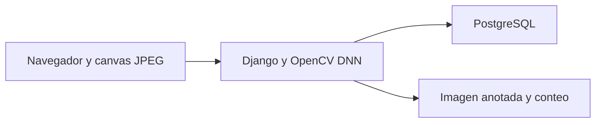
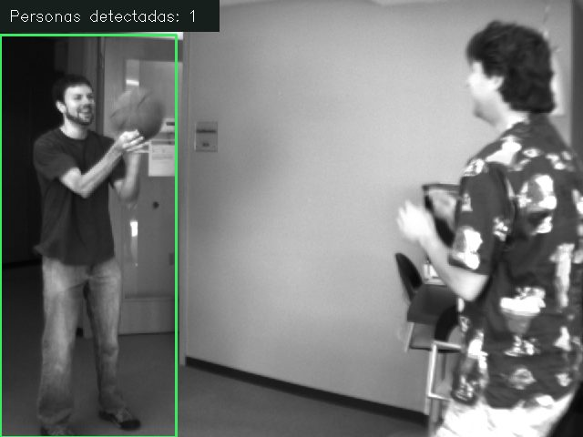
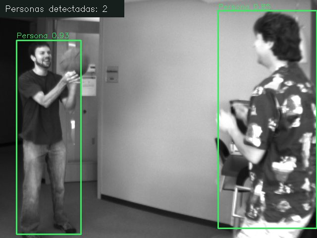
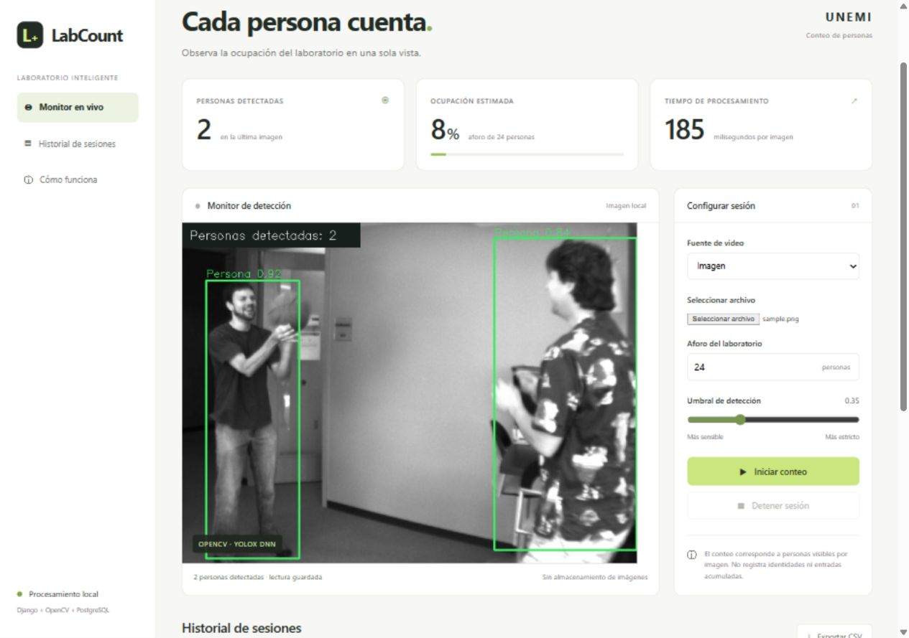
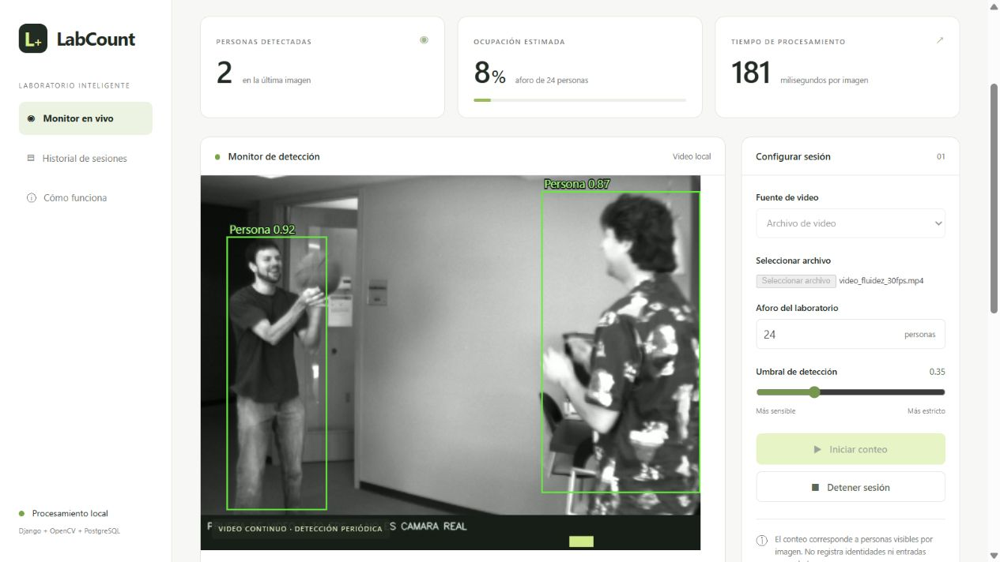

# Conteo de personas en el laboratorio
## Informe de construcción del aplicativo LabCount

Universidad Estatal de Milagro
Facultad Ciencias e Ingenierías
Carrera de Software en modalidad presencial
Asignatura Construcción de Software
Práctica 03
10 de noviembre de 2026

### Resumen
LabCount integra Django, OpenCV y PostgreSQL para estimar cuántas personas son visibles en una imagen o en las muestras de un video. El navegador captura la fuente seleccionada, el servidor ejecuta YOLOX con OpenCV DNN y la interfaz muestra recuadros, conteo, ocupación y tiempo de procesamiento. PostgreSQL conserva las lecturas numéricas y permite consultar el historial y exportarlo como CSV.

La aplicación se desarrolló localmente y el proyecto se abrió en Visual Studio Code. Se aprobaron 22 pruebas de backend con PostgreSQL real y nueve pruebas JavaScript de interfaz. En una imagen pública de dos personas, el prototipo HOG detectó una y la implementación YOLOX detectó dos. También se verificaron imágenes, video local, alerta de aforo y exportación desde el navegador.

### Objetivo general
Construir un aplicativo web en Django que procese imágenes de cámara o video con OpenCV, cuente personas visibles y presente resultados útiles mediante una interfaz interactiva y persistencia en PostgreSQL.

### Objetivos específicos
- Capturar imágenes desde el navegador y enviarlas secuencialmente al servidor.
- Detectar la clase persona mediante un modelo preentrenado ejecutado en OpenCV.
- Mostrar detecciones, conteo por imagen y alerta cuando se supera el aforo configurado.
- Guardar resultados y verificar el comportamiento con pruebas reproducibles.

### Alcance del resultado
El conteo representa detecciones por imagen. No identifica individuos, no registra asistencia y no acumula visitantes únicos. La validación realizada utiliza material controlado; la cámara física y un laboratorio ocupado requieren una prueba de campo antes de afirmar precisión de uso real.


---

# Requisitos y diseño de la solución

### Correspondencia con la guía
| Requisito | Implementación y evidencia |
| --- | --- |
| Backend Python y Django | Proyecto config y aplicación counter con rutas, vistas y modelos |
| OpenCV obligatorio | Decodificación JPEG, red DNN, NMS, dibujo y codificación con cv2 |
| Captura y video en tiempo real | Cámara o video capturados en el navegador y analizados por muestras |
| Resultados sobre el video | Recuadros, puntuación y conteo dibujados en la imagen retornada |
| Base PostgreSQL | Sesiones y lecturas relacionadas con clave foránea; migraciones incluidas |
| Interfaz y pruebas | Panel responsive, errores, alertas, historial, CSV y 22 pruebas |
| README y requirements | Incluidos en la raíz del proyecto y en el paquete fuente |
| GitHub y video en Drive | Publicación pendiente; se entregan código y demostración local |

### Arquitectura

El navegador utiliza getUserMedia para la cámara o un objeto URL para el archivo local. Un canvas produce imágenes JPEG. Django recibe cada muestra con protección CSRF y la pasa a counter/detection.py. El resultado retorna como JSON con imagen anotada. La misma petición registra una lectura en PostgreSQL.

### Organización del proyecto
```text
config/       settings.py   urls.py   wsgi.py
counter/      models.py     views.py  detection.py  tests.py
              migrations/  templates/  static/
models/       YOLOX ONNX    licencia  SHA256SUMS.txt
scripts/      run_local.py  download_model.py
.vscode/      launch.json   tasks.json  settings.json
docs/         informe      bitácora  evidencias  videos
```

Se separó el detector de las vistas para reutilizarlo sin navegador en las pruebas. El modelo ONNX es preentrenado; este trabajo integra y configura el modelo, no realiza un entrenamiento nuevo. Las licencias y fuentes se conservan en THIRD_PARTY_NOTICES.md.


---

# Configuración inicial paso a paso

### Paso 1 Abrir el proyecto en Visual Studio Code
Seleccionar File y Open Folder y abrir la carpeta conteo_personas. El explorador muestra config, counter, models, scripts y docs. Seleccionar el intérprete .venv/Scripts/python.exe desde Python Select Interpreter cuando la extensión Python esté disponible. Las configuraciones de ejecución y tareas se incluyen en .vscode.

### Paso 2 Preparar Python y dependencias
En una nueva instalación Windows con Python 3.11, ejecutar desde la raíz del proyecto los comandos siguientes. No es necesario activar el entorno ni cambiar la política de ejecución de PowerShell.
```powershell
python -m venv .venv
.\.venv\Scripts\python.exe -m pip install -r requirements.txt
Copy-Item .env.example .env
```

### Paso 3 Configurar PostgreSQL
Editar .env con nombre de base conteo_personas, usuario conteo, host 127.0.0.1 y puerto 55432. Definir una contraseña propia y una SECRET_KEY aleatoria. El archivo real no se incluye en el ZIP ni se publica. Con PostgreSQL instalado, crear usuario y base con pgAdmin o psql; para las pruebas Django, el usuario requiere CREATEDB.
```sql
CREATE ROLE conteo LOGIN PASSWORD 'tu_clave_local' CREATEDB;
CREATE DATABASE conteo_personas OWNER conteo;
```
Como alternativa, compose.yaml configura PostgreSQL 17 y publica solo el puerto local 55432. Después de editar .env, ejecutar docker compose up -d db y esperar a que el servicio esté disponible. En este computador se usó PostgreSQL portátil en work/pgdata, sin sustituirlo por SQLite.

### Paso 4 Preparar el modelo y las tablas
```powershell
.\.venv\Scripts\python.exe scripts\download_model.py
.\.venv\Scripts\python.exe manage.py migrate
.\.venv\Scripts\python.exe manage.py check
```
El modelo ya se entrega en el paquete. El script de descarga compara su SHA256 y solo lo reemplaza con un archivo verificado. migrate aplica las migraciones de sesiones, lecturas y la actualización del umbral a 0.35.

### Paso 5 Iniciar el aplicativo
Ejecutar Iniciar.cmd en este equipo o la tarea LabCount iniciar en VS Code. También puede ejecutarse .venv/Scripts/python.exe scripts/run_local.py. Abrir http://127.0.0.1:8000/ y pulsar Probar ejemplo. F5 permite depurar con la configuración LabCount Django si Python Debugger está instalado y PostgreSQL ya está activo.


---

# Sesión 1 Captura y transmisión de video

### Paso 6 Seleccionar y preparar la fuente
La interfaz permite cámara del computador, archivo de video, imagen o ejemplo público. La cámara utiliza navigator.mediaDevices.getUserMedia con video y audio desactivado. El navegador solicita el permiso correspondiente al usuario. En archivos, URL.createObjectURL permite reproducir el video local sin subir el archivo completo al servidor.

### Paso 7 Capturar una imagen
Se toma el ancho y alto de la fuente y se escala manteniendo proporciones hasta un máximo de 800 por 600 píxeles. Canvas dibuja la imagen y toBlob la convierte en JPEG con calidad 0.85. La petición multipart incluye frame y threshold. La cookie de sesión y la cabecera X-CSRFToken acompañan la petición.

### Paso 8 Transmitir y recibir el resultado
POST /api/sessions/ crea una sesión con fuente y aforo. Cada muestra se envía a POST /api/sessions/{id}/frames/. La respuesta contiene count, boxes, processing_ms, image y over_capacity. El campo image es una imagen JPEG anotada en base64 que se presenta en el monitor.

### Paso 9 Regular el procesamiento
La cámara y el archivo se reproducen continuamente en un elemento de video nativo. La inferencia analiza muestras y dibuja los recuadros en una capa SVG independiente, alineada con la proporción del video. Las peticiones tienen un intervalo objetivo mínimo de 250 ms entre inicios y nunca se solapan. Si la inferencia tarda más, la siguiente espera; la reproducción continúa. La cámara solicita hasta 30 FPS, según dispositivo y navegador. Se retiran recuadros sin actualizar durante 1.2 segundos. No se analizan todos los fotogramas.

### Paso 10 Finalizar sin lecturas tardías
Detener sesión cambia el estado del bucle, espera la petición pendiente, pausa el video, libera las pistas de cámara y revoca el objeto URL. Una promesa de cierre evita dos cierres simultáneos. El backend bloquea la fila de la sesión durante el cierre o registro y rechaza con HTTP 409 una nueva lectura de una sesión cerrada. pagehide intenta enviar el cierre mediante sendBeacon; una terminación abrupta del navegador puede dejar una sesión marcada como activa.

### Fórmulas de la interfaz
- Conteo actual igual al número de recuadros de persona conservados tras NMS.
- Ocupación porcentual igual a conteo actual dividido para aforo y multiplicado por 100.
- Alerta cuando conteo actual es mayor que el aforo. El porcentaje puede superar 100.
- Máximo y promedio calculados sobre las imágenes procesadas de cada sesión. No son el número total de visitantes ni un promedio temporal ponderado.


---

# Sesión 2 Procesamiento y detección

### Paso 11 Revisar el prototipo HOG
Se configuró HOGDescriptor con el clasificador SVM de personas incluido en OpenCV. La imagen basketball1.png contiene dos personas visibles; el prototipo devolvió una detección. Se conservaron el JSON y la imagen anotada en docs/evidencias. Este caso motivó sustituir el detector.





### Paso 12 Integrar YOLOX con OpenCV DNN
El archivo object_detection_yolox_2022nov.onnx se obtuvo de la distribución de OpenCV Zoo. cv2.dnn.readNetFromONNX carga la red y la ejecuta en CPU. Cada hilo mantiene su propia instancia para no compartir buffers mutables de inferencia.

### Paso 13 Preparar y decodificar las predicciones
Se decodifica el JPEG con cv2.imdecode, se verifica su tamaño y se transforma BGR a RGB. Un letterbox mantiene la proporción, redimensiona a una región de entrada de 640 por 640 y rellena los bordes derecho e inferior con valor 114. El tensor usa el orden NCHW y valores de entrada sin dividir para 255, conforme al modelo.

Los centros se decodifican con las cuadrículas y strides 8, 16 y 32; anchos y altos usan la exponencial de la salida. Se calcula la puntuación de cada clase multiplicando objectness por la puntuación de clase. Se conservan predicciones cuya clase de mayor puntuación es persona y cuyo valor alcanza el umbral configurado.

### Paso 14 Eliminar duplicados y dibujar
cv2.dnn.NMSBoxes aplica supresión no máxima con IoU de 0.45. Se revierten las coordenadas del letterbox, se ajustan al borde de la imagen y se dibujan recuadros y etiquetas. El umbral inicial es 0.35 y puede ajustarse entre 0.1 y 0.95. La puntuación del modelo no es una probabilidad calibrada. En la imagen original YOLOX conservó las dos personas.


---

# Sesión 3 Interfaz y uso del aplicativo



Figura 1. Captura real del aplicativo procesando una imagen local de dos personas. La imagen de ejemplo procede de OpenCV; no corresponde a una grabación de campo del laboratorio.

### Paso 15 Interpretar el panel
El indicador de personas refleja la última imagen analizada. El de ocupación usa el aforo que se fijó al crear la sesión. El tiempo de procesamiento se mide en el servidor desde la decodificación hasta la codificación del resultado; no incluye toda la latencia del navegador. El monitor muestra el resultado anotado y la fuente de origen.

### Paso 16 Ejecutar una sesión
Elegir fuente, configurar aforo y mantener inicialmente umbral 0.35. Cargar el archivo si corresponde y pulsar Iniciar conteo. Una imagen se procesa una sola vez; cámara y video continúan tomando muestras. Detener libera los recursos. Si el conteo supera el aforo, el panel muestra una alerta.

### Paso 17 Consultar y exportar
Historial presenta hasta 30 sesiones, de reciente a antigua, con fuente, estado, cantidad de imágenes, máximo y promedio. Exportar CSV descarga todas las lecturas asociadas al navegador, con fecha de Ecuador, aforo, umbral y tiempo. El CSV se comprobó mediante descarga real y prueba automatizada. También se inspeccionó el diseño en 390 píxeles de ancho; las columnas del historial se pueden desplazar horizontalmente.


---

# Persistencia y documentación de la API

### Modelo de datos
| Entidad | Campos y función |
| --- | --- |
| CountingSession | id UUID, owner, source, capacity, started_at y ended_at |
| Reading | id, session_id, created_at, count, processing_ms y threshold |
| Relación | Una sesión puede tener muchas lecturas; session_id es clave foránea |
| Identificación local | owner corresponde a la clave de sesión Django del navegador |
| Persistencia | PostgreSQL conserva números y metadatos; no guarda imágenes del usuario |

### Endpoints y respuestas
| Método y ruta | Entrada y respuesta principal |
| --- | --- |
| GET / | Interfaz y cookie CSRF |
| GET /api/sessions/ | Lista de sesiones propias y agregados; HTTP 200 |
| POST /api/sessions/ | JSON source y capacity; retorna id; HTTP 201 |
| POST /api/sessions/{id}/frames/ | Multipart frame y threshold; conteo e imagen; HTTP 200 |
| POST /api/sessions/{id}/stop/ | Cierre idempotente de sesión; HTTP 200 |
| GET /api/export.csv | Descarga de lecturas propias con cabecera CSV y UTF8 BOM |

### Validación y manejo de errores
La API admite aforo entero de 1 a 1000 y únicamente las cuatro fuentes definidas. El umbral debe ser finito y estar entre 0.1 y 0.95. Una imagen puede pesar hasta 3 MB y medir entre 64 y 4096 píxeles por lado. Los límites de carga de Django son de 4 MB. Los archivos corruptos o parámetros inválidos producen HTTP 400; una sesión ajena produce 404; una sesión cerrada, 409; y un modelo que no puede ejecutarse, 503.

El uso incorrecto de un método genera 405 y una petición sin CSRF válido, 403. Las vistas filtran las sesiones y el CSV por la clave del navegador. Esto ofrece separación entre sesiones locales, pero no constituye autenticación de usuarios para un servicio compartido. DEBUG y el servidor de desarrollo están configurados para localhost. Un despliegue público necesitaría configuración de producción y un sistema de usuarios.

### Reutilización
El detector se invoca desde la API y desde las pruebas sin duplicar su lógica. Los modelos del ORM proporcionan migraciones y agregación de lecturas. La captura usa el mismo canvas para cámara, video e imagen; los parámetros se validan también en el servidor.


---

# Pruebas realizadas y resultados

### Paso 18 Ejecutar las pruebas automáticas
```powershell
.\.venv\Scripts\python.exe manage.py test counter --verbosity 2
```
La ejecución final aprobó 22 pruebas en 0.795 segundos con base temporal PostgreSQL test_conteo_personas. Django informó cero incidencias de sistema. La salida está en docs/evidencias/pruebas_automatizadas.txt. Además aprobaron nueve pruebas JavaScript de reproducción, superposición, caducidad, cierre y concurrencia. El usuario PostgreSQL de pruebas requiere permiso para crear bases.

| Grupo comprobado | Evidencia de comportamiento |
| --- | --- |
| Detector real | Dos personas en imagen; cero en imagen negra; JPEG anotado válido |
| Postprocesamiento | NMS conserva cajas distintas y elimina superposición; lista vacía |
| Validación | JSON, fuente, aforo, umbral no finito, tamaño y archivo corrupto |
| Persistencia | Detección real guardada y agregada en PostgreSQL; exportación coherente |
| Aislamiento | Otro navegador no lista, cierra ni procesa sesiones ajenas |
| Cierre | Es idempotente y no acepta nuevas lecturas después de terminar |
| Manejo de fallos | CSRF, métodos indebidos y fallo de modelo no guardan una lectura |
| Historial | Se verifica explícitamente el orden de sesiones recientes primero |

### Paso 19 Comparar variantes controladas
Se aplicó el mismo umbral 0.35 a cinco condiciones, con tres ejecuciones por condición. El tiempo medio incluye la carga de la red en la primera inferencia del proceso. Son variantes de una única imagen pública; no son escenas independientes ni permiten inferir precisión general.

| Condición | Manual | Detectado | Error absoluto | Media ms |
| --- | --- | --- | --- | --- |
| Imagen original | 2 | 2 | 0 | 229.5 |
| Sin personas | 0 | 0 | 0 | 173.1 |
| Brillo reducido al 35 por ciento | 2 | 2 | 0 | 175.1 |
| Desenfoque gaussiano | 2 | 2 | 0 | 179.9 |
| Imagen reflejada | 2 | 2 | 0 | 182.8 |

El error absoluto de conteo fue cero en las cinco condiciones ensayadas. Esta coincidencia no equivale a demostrar precisión de 100 por ciento en un laboratorio. No se calcularon precisión o recall de cajas: no se dispone de un conjunto de anotaciones y correspondencias para esa evaluación.

### Verificación desde el navegador
Se comprobó el ejemplo, la carga de una imagen, un MP4 controlado, la alerta con aforo de uno, el cierre, el historial y la descarga CSV. La sesión de video registrada produjo 28 lecturas, máximo de dos y promedio mostrado de 1.1. El video de prueba intercala cuadros negros y una imagen repetida; no representa movimiento real de personas.


---

# Cambios y decisiones de construcción

### Paso 20 Registrar la evolución
| Cambio | Causa | Resultado verificable |
| --- | --- | --- |
| Prototipo HOG a YOLOX | Una persona omitida en la imagen de dos | YOLOX detectó ambas; evidencia comparativa conservada |
| Umbral 0.5 a 0.35 | Cambió el tipo de puntuación del detector | Interfaz, API, modelo y migración 0002 coherentes |
| Entrada con letterbox | Evitar deformar personas al redimensionar | Proporción mantenida y coordenadas revertidas |
| Video nativo y captura secuencial | Evitar que la inferencia frene el video o acumule solicitudes | Reproducción continua y una inferencia pendiente por fuente |
| Datos numéricos por sesión | Consultar resultados sin guardar videos | Sesiones y lecturas PostgreSQL y CSV |
| Validaciones y cierre bloqueado | Evitar parámetros inválidos y lecturas tardías | Pruebas con 400, 403, 404, 405, 409 y 503 |
| Cierre coordinado en JavaScript | Detener y fin de video pueden coincidir | Promesa compartida y cancelación de temporizadores |
| Orden explícito del historial | La agregación no garantizaba el orden esperado | Consulta order_by y prueba de regresión |
| Ajuste de singular en aforo | La etiqueta mostraba una personas | Etiqueta de una persona corregida |
| Entorno Visual Studio Code | Trabajar con el IDE indicado | Proyecto abierto, detector editado y tareas incluidas |

La bitácora completa se conserva en docs/BITACORA.md. Describe cambios realizados, no una historia retrospectiva de commits. La publicación del repositorio está pendiente y no se presenta como realizada.

### Decisiones de calidad
Se mantuvo PostgreSQL como base de desarrollo y pruebas. Se fijaron versiones de las dependencias comprobadas. Se incluyeron migraciones, licencias y suma SHA256 del modelo. La configuración local con credenciales y el entorno virtual quedan fuera del paquete fuente. La aplicación funciona en CPU y no envía imágenes a un servicio de inferencia externo.

### Limitaciones observadas y pendientes
La validación de laboratorio debe incluir personas sentadas, oclusión, grupos densos, distancias distintas y cambios reales de iluminación. Una detección omitida reduce el conteo; un falso positivo lo aumenta. Aforo es una referencia configurada y la alerta no reemplaza una medición certificada. Un cierre abrupto del navegador puede no finalizar la sesión. No existe seguimiento temporal ni control de identidad.


---

# Manual de ejecución y mantenimiento

### En este equipo
1. Abrir la carpeta conteo_personas en Visual Studio Code.
2. Ejecutar Iniciar.cmd o la tarea LabCount iniciar. El script detecta PostgreSQL local y, si es necesario, inicia el servidor portátil de work.
3. Abrir http://127.0.0.1:8000/ en un navegador y usar el ejemplo o cargar un archivo.
4. Para cámara, seleccionar la fuente y autorizar su uso directamente en el navegador. La cámara física no fue validada en esta ejecución.
5. Detener la sesión antes de cambiar de fuente. Consultar el historial y descargar el CSV.
6. Detener Django con Ctrl+C. Si se desea detener PostgreSQL portátil, usar pg_ctl con el directorio work/pgdata y modo fast. Con Docker, usar docker compose stop db.

### Resolución de problemas
| Síntoma | Acción |
| --- | --- |
| No conecta a PostgreSQL | Comprobar servidor iniciado, puerto 55432 y credenciales de .env |
| Error de tabla inexistente | Ejecutar manage.py migrate con el intérprete del proyecto |
| Falta el modelo | Ejecutar scripts/download_model.py y comprobar SHA256SUMS.txt |
| Cámara no disponible | Verificar dispositivo, permiso y que otra aplicación no la use; probar video |
| El video no se reproduce | Usar MP4 H.264 compatible con el navegador |
| Pocos resultados o falsos positivos | Comprobar luz y encuadre; ajustar umbral y comparar con conteo manual |
| Puerto 8000 ocupado | Detener la instancia previa; no iniciar dos servidores simultáneamente |
| Historial vacío en otro navegador | Usar el navegador y cookie de sesión de origen; no se borraron los datos |
| F5 no encuentra Python Debugger | Instalar las extensiones recomendadas o usar Iniciar.cmd |

### Validación de campo propuesta
Antes de usarlo como estimador de ocupación del laboratorio, registrar escenas de cero, una y varias personas, sentadas y de pie, con conteo manual. Medir error absoluto por muestra y tasa de falsos positivos, y documentar iluminación, resolución y posición de cámara. Si se añaden anotaciones de cajas, evaluar también precisión y recall con un IoU definido. Estas pruebas están propuestas, no realizadas.

### Conclusión
La implementación conecta captura, inferencia OpenCV, persistencia y visualización. Las pruebas locales respaldan el funcionamiento del flujo y la mejora sobre el prototipo en el ejemplo ensayado. La documentación permite reproducir la instalación y revisar los cambios. La evaluación en el laboratorio y la publicación de enlaces externos completarán la validación y entrega académica.


---

# Entregables y referencias

### Archivos de la entrega local
| Elemento | Ubicación relativa |
| --- | --- |
| Informe PDF | ../Informe_conteo_personas.pdf respecto a la raíz del proyecto |
| Código fuente | Carpeta conteo_personas y paquete Entrega_LabCount.zip |
| Instalación y uso | README.md e Iniciar.cmd |
| Proceso editable | docs/informe.md |
| Cambios | docs/BITACORA.md |
| Evidencias y pruebas | docs/evidencias/ |
| Demostración de pantalla | docs/video_demostracion.mp4 |
| Material para probar video | docs/video_prueba.mp4 |
| Guion de grabación | docs/GUION_VIDEO.md |

La demostración se construyó con capturas reales de la interfaz tomadas desde este computador y editadas para reducir esperas. No utiliza una grabación de teléfono. Muestra el conteo de ejemplo, la configuración de aforo, el procesamiento de video local, el cierre y el historial. No demuestra una cámara física funcionando ni reemplaza la participación de los integrantes en la práctica.

### Enlaces de publicación
GitHub permanece pendiente de publicación. El video se entrega localmente; todavía no existe un enlace de Drive publicado. Cuando se publiquen, incorporar aquí los dos enlaces reales y comprobar el permiso de visualización. Estos campos no se sustituyen por URLs inventadas.

### Referencias técnicas y material reutilizado
1. Universidad Estatal de Milagro. Guía de práctica 03 G003 S12 SOFTWARE2019 PRESENCIAL CONSTRUCCIÓN DE SOFTWARE A5. Documento proporcionado, 3 páginas, 10 de noviembre de 2026.
2. Django Software Foundation. Documentación Django 5.2 y configuración de PostgreSQL. https://docs.djangoproject.com/en/5.2/ref/databases/
3. OpenCV. OpenCV Zoo y modelo Object Detection YOLOX. https://github.com/opencv/opencv_zoo/tree/main/models/object_detection_yolox
4. OpenCV. Distribución del modelo ONNX. https://huggingface.co/opencv/object_detection_yolox
5. OpenCV. Imagen basketball1.png de la distribución 4.12.0. https://github.com/opencv/opencv/blob/4.12.0/samples/data/basketball1.png
6. PostgreSQL Global Development Group. Documentación PostgreSQL 17. https://www.postgresql.org/docs/17/

Las licencias de modelo e imagen están incluidas en el proyecto. Las referencias se consultaron durante la implementación del 10 de noviembre de 2026. El modelo es preentrenado; no se atribuye su autoría al desarrollo de esta aplicación.


---

# Mejora de la fluidez del video



### Cambio solicitado
La versión inicial mostraba solo las imágenes procesadas y añadía una espera de 350 ms tras cada respuesta. Esto hacía que la vista tuviera aproximadamente la frecuencia de las detecciones. Se reemplazó esa vista por la reproducción nativa de video y una capa SVG para los recuadros.

### Implementación y validación
El video permanece visible durante la petición. Las cajas usan un viewBox con las dimensiones de la muestra y mantienen la alineación con object fit contain. El intervalo objetivo de detección es 250 ms entre inicios, con una sola petición pendiente. Al detener se cancelan los temporizadores, se libera la fuente y se muestra la última imagen anotada.

Se comprobó un archivo controlado de 20 segundos y 30 FPS con un indicador móvil. El elemento de video permaneció visible y en reproducción mientras se procesaban muestras y había dos recuadros. En cinco observaciones el tiempo de reproducción avanzó de 0.270 a 3.054 segundos. No se midieron los FPS renderizados de una cámara física ni se afirma que todos los fotogramas reciban inferencia.

Las nueve pruebas JavaScript aprobaron. Se corrigió también el fallo replaceChildren al recibir una plantilla anterior sin la capa SVG: ahora se crea automáticamente y no bloquea el cierre de la cámara. Se verificó la corrección con esa plantilla real. Las capturas y observaciones están en docs/evidencias. La demostración original documenta la versión anterior. Recargar con Ctrl más F5 carga el JavaScript corregido.
